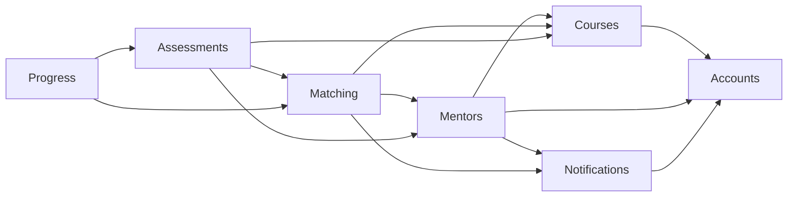
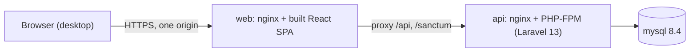
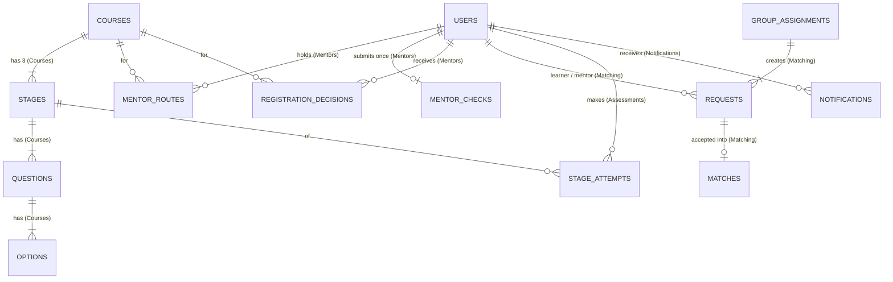

# Architecture Spine — GrowMate

## Design Paradigm

**A modular monolith API with a thin client SPA.**
- One Laravel API owns every fact, rule and derived state. It is split into domain modules that change data only through their own Actions.
- A separate React SPA renders API responses and nothing else.
- Both apps are served from one origin: `web` proxies `/api` to `api`.
- Glossary terms (`glossary.md`) name modules, entities and API fields exactly.

| Layer | Lives in | Owns |
| --- | --- | --- |
| API modules | `api/app/Modules/<Module>/` (`Actions/`, `Models/`, `Queries/`, `Http/`, `Policies/`, `ErrorCode.php`, `Database/Seeders/`) | Tables, rules, derived state, its error codes |
| API transport | `api/routes/api.php` → `/api/v1` | Routing, auth, `JsonResource` responses |
| SPA shell | `web/src/app/` (owned by epic 1) | Router, layout, auth session, copy file |
| SPA features | `web/src/features/<module>/` | Screens and routes for that module |
| SPA API client | `web/src/api/` (`client.ts`, `types/<module>.ts`) | HTTP calls and resource types |

### Module creation by epic

| Epic | Creates | Extends |
| --- | --- | --- |
| 1 Accounts, Courses, first Mentors | Accounts, Courses, Mentors, Notifications, SPA shell, `e2e/` harness | — |
| 2 Requests and Matches | Matching (including `group_assignments` table and `requests.group_assignment_id`), Progress | Notifications (notice types, `TimeNoticeSource` contract) |
| 3 Stages and Gold | Assessments | Courses (AD-14 taking read), Progress (Completed, Stage progress) |
| 4 Group assignment | — | Matching (group Actions, admin route), Accounts (admin Employee-list read), Mentors (admin refused-for-Course read) |

## Invariants & Rules

### AD-1 — Two apps, one origin, talking only through `/api/v1` [ADOPTED]

- **Binds:** all
- **Prevents:** a mix of server-rendered pages and SPA screens, data read any other way, and per-host builds.
- **Rule:**
  - GrowMate is a Laravel API (`api/`) and a separate React SPA (`web/`). There is no Inertia and no Blade UI.
  - The SPA reaches data only through relative JSON calls to `/api/v1/...`.
  - `web`'s nginx serves the SPA and proxies `/api` and `/sanctum` to `api`.
  - No API URL is baked into the SPA build, and no CORS configuration exists.

### AD-2 — Business rules live only in the API [ADOPTED]

- **Binds:** all; R7, R9, R16–R20 in particular
- **Prevents:** the SPA and the API computing a Request state, Lock, Progress status, date or eligibility differently.
- **Rule:**
  - The SPA never derives state. It renders the fields the API returns, including every status, date and eligibility.
  - The API's refusal (AD-10) is the authority on any action.

### AD-3 — Modules own their tables and change them only through Actions

- **Binds:** all
- **Prevents:** two epics writing the same table, and rules bypassed by direct model writes.
- **Rule:**
  - Each table belongs to exactly one module (see the ERD).
  - Rows change only through that module's Actions (single-purpose classes, such as `SendRequest` or `GrantMentor`). Each Action runs in one DB transaction.
  - Other modules call those Actions, or read through the owner's `Queries/`. They never import another module's Models or query its tables.
  - Controllers validate, call one Action or Query, and return a `JsonResource`.
  - Dependencies point one way:



### AD-4 — Store facts, derive state

- **Binds:** R7, R9, R13–R15, R18, R20, R21
- **Prevents:** status columns that one epic updates and another forgets to.
- **Rule:**
  - Tables store only what happened:
    - sent and accepted times;
    - match start and end, with `end_reason` of `quit` or `course_completed`, quit by, and quit reason;
    - attempts, with score, `passed` and the `pass_mark` used;
    - decisions and grants.
  - These states are never stored. Each is computed by exactly one Query, and every list and screen calls it:
    - Request state (pending, reminded, cancelled, accepted): `Matching\Queries\RequestState`;
    - Stage availability and Lock: `Assessments\Queries\StageAvailability`;
    - Progress status: `Progress\Queries\ProgressStatus`.
  - `Progress` is read-only and owns no tables. It also serves the Upskilling list (R21).
  - Within one entity, facts are ordered by `id`, never by timestamp.

### AD-5 — One clock, UTC, time rules derived on read [ADOPTED]

- **Binds:** R9, R15, R18, R22
- **Prevents:** one epic using wall-clock time or cron while another uses the clock, and tests that must wait 6 or 30 days.
- **Rule:**
  - All time comes from Laravel `now()`, which is Carbon.
  - Never call `time()`, `date()`, `new DateTime()`, `Date.now()` or SQL `NOW()`/`CURRENT_TIMESTAMP` for a rule. Queries take `now()` as a bound parameter.
  - Timestamps are stored and returned in UTC. Every date the SPA shows is the UTC calendar date of that timestamp.
  - Day 3, day 6 and the Lock are derived from stored timestamps against `now()`, never by scheduled jobs.
  - A derived event is dated with its rule date. For example, the day-3 reminder is dated `sent_at + 3 days`.
  - The Lock ends at `second_failure_at->addMonthNoOverflow()`, and nothing can configure it.

### AD-6 — Test clock: persisted, applied by middleware, never in production

- **Binds:** R9, R18; the `e2e/` harness (epic 1)
- **Prevents:** each epic inventing its own time travel, and time that resets on every PHP-FPM request.
- **Rule:**
  - API tests use `$this->travel()`.
  - In the `e2e` environment only, `POST /api/v1/testing/clock` stores one frozen instant (a cache or file read by the API).
  - The `ApplyTestClock` middleware, registered only when `APP_ENV` is `e2e`, calls `Carbon::setTestNow` with that instant on every request.
  - No other time hook exists. The `local` and `production` environments never register either the route or the middleware.

### AD-7 — Mentor status: one row per Employee and Course, written only by `GrantMentor`

- **Binds:** R3, R10, R11, R19
- **Prevents:** two epics writing Mentor status differently, and two routes for one Course.
- **Rule:**
  - `mentor_routes` has a unique key on (`user_id`, `course_id`) and a `route` of `gold_pass`, `registration_approval` or `group_assignment_accepted`.
  - Only `Mentors\Actions\GrantMentor` writes it.
  - A grant for an existing pair does nothing, so the first route is kept.
  - "Is a Mentor for Course X" is answered only by `Mentors\Queries`.

### AD-8 — Hidden fields, with three named exceptions

- **Binds:** R3, R6, R8, R10–R13, R22, C4, C6, C10
- **Prevents:** one endpoint or notice revealing what another hides.
- **Rule:** No response or notice ever includes a Mentor `route`. `group_assignment_id`, or anything that reveals a group, is excluded from every response and notice, with these exceptions:
  1. The chosen Employee's own incoming-Requests view shows their pending group as one block naming each Learner, with one Accept and no count.
  2. An Employee sees their own Registration decisions as approved and refused lists.
  3. Admin sees only the Registration decisions and Group assignments Admin created. Admin never sees routes, Request or Match state, or whether a group was Accepted.

  A Quit reason is returned only to the other party of that Match.

### AD-9 — Auth: Sanctum SPA cookie sessions [ADOPTED]

- **Binds:** R1, C2, C4; every endpoint
- **Prevents:** per-epic auth schemes, and token theft.
- **Rule:**
  - The SPA authenticates through Laravel Sanctum's first-party SPA cookie sessions on the shared origin (AD-1): `GET /sanctum/csrf-cookie`, then `POST /login`.
  - Every protected `/api/v1` route uses the `auth:sanctum` guard. No API tokens are issued, and nothing auth-related is kept in `localStorage`.
  - Sign-out invalidates the session.
  - The SPA never renders raw HTML: no `dangerouslySetInnerHTML`, and user text is always rendered as text.
  - Admin is `users.is_admin`, seeded at setup. Admin endpoints sit under `/api/v1/admin/*` behind one `admin` gate.
  - Matching's only admin endpoint is `POST /api/v1/admin/group-assignments`. It writes only, and returns the created assignment with no Request or Match state.

### AD-10 — One API contract

- **Binds:** all endpoints
- **Prevents:** response and error shapes drifting between epics and between the API and the SPA types.
- **Rule:**
  - REST under `/api/v1` with plural kebab-case paths.
  - Every response is a Laravel `JsonResource` (never `JsonApiResource`): `{ "data": … }`, plus `links` and `meta` only for paginated lists.
  - JSON keys are snake_case. Timestamps are ISO-8601 UTC with `Z`. Ids are integers, except notice ids, which are strings (AD-11).
  - Errors use one shape, `{ "message": string, "code"?: string, "errors"?: { field: [string] } }`:
    - `422` for validation;
    - `409` for a rule refusal, with a `code` from the owning module's `ErrorCode` enum (string values prefixed by the module, e.g. `MATCHING_REQUEST_ALREADY_OPEN`);
    - `403` and `404` as usual.
  - SPA types are hand-written in `web/src/api/types/<module>.ts`, one file per module. They change in the same commit as the Resource.

### AD-11 — One notice pipeline and one Notice shape [ADOPTED]

- **Binds:** R3, R8, R9, R13, R14, R22, C3
- **Prevents:** epics sending notices through different paths, ids or shapes, a notice reaching Admin, and time notices that disagree with Request state.
- **Rule:**
  - Event notices are sent only through `Notifications\Actions\SendNotice`, after the calling transaction commits, using Laravel's database channel. The type comes from the closed `NoticeType` enum, which matches R22.
  - Day-3 and day-6 notices are never stored. `Notifications` defines a `TimeNoticeSource` contract. `Matching` implements it from `RequestState` and registers it.
  - The inbox endpoint returns one list, newest `occurred_at` first. Each entry has this shape: `{ id: string, type: NoticeType, occurred_at, ...type fields }`. Derived notices get the id `"<type>:<request_id>"`.
  - Admin is never a recipient. Payloads obey AD-8.

### AD-12 — One shared eligibility check for Learners (R7)

- **Binds:** R7, R10, C4
- **Prevents:** `SendRequest` and Group assignment checking R7 differently or racing, and Admin learning Request or Match state from refusals.
- **Rule:**
  - `Matching\Queries\LearnerEligibility` is the only implementation of R7's refusals. `SendRequest` and the group Actions both call it inside their transaction, with a row lock on the Learner and Course.
  - Employees receive specific Matching codes.
  - Admin receives only `MATCHING_LEARNER_NOT_ASSIGNABLE` for any ineligible Learner, and `MATCHING_MENTOR_NOT_ELIGIBLE` for a refused chosen Employee.

### AD-13 — One Accept path, groups included

- **Binds:** R8, R10, R11
- **Prevents:** epics 2 and 4 building two Accept flows, and a chosen non-Mentor who never sees their group.
- **Rule:**
  - `Matching\Actions\AcceptRequest` is the only Accept.
  - For a grouped Request, it accepts every pending sibling in the group at once. It then calls `GrantMentor(route: group_assignment_accepted)` and creates one Match per Learner.
  - The incoming-Requests screen is available to every Employee, not only Mentors.

### AD-14 — Published Courses are frozen; taking never sees answers

- **Binds:** R4, R5, R16–R19
- **Prevents:** a later edit flipping past passes, Locks or Completed without a Mentor grant, and answers leaking to Learners.
- **Rule:**
  - Once published, a Course's Stages, questions, options and Pass marks cannot change.
  - A pass is judged once, at submission, and stored with the `pass_mark` used.
  - `Courses\Queries` exposes separate authoring and taking reads. The taking read never includes which option is correct, and scoring happens only in the API.

### AD-15 — The Mentor check is enforced by the server

- **Binds:** R2, R3
- **Prevents:** the once-only rule depending on the SPA's sign-up sequence.
- **Rule:**
  - `Mentors\Actions\SubmitMentorCheck` accepts exactly one submission per Employee, either a list of Courses or an explicit skip, and records it.
  - It accepts only Courses published before the Employee's account was created. Any later call is refused.

### AD-16 — Bare surface

- **Binds:** R8, R12, R20, R21, C5, C7–C9
- **Prevents:** epics adding numbers, helper text, nudges or reason fields that the principles forbid.
- **Rule:**
  - Progress is shown only as one of four states: grey, half blue, green or red. There are no numbers, percentages, markers or activity signals.
  - No helper text, nudges or extra notices beyond R22 exist.
  - Only Quit takes free text.
  - User-facing sentences, such as R8's "[Learner] requested you to guide them with [Course]", live in one SPA copy file (`web/src/app/copy.ts`).

### AD-17 — Environments and Docker deployment

- **Binds:** C1; the platform baseline (epic 1); every epic's "deployed" check
- **Prevents:** each epic assuming a different runtime, environment or meaning of "deployed".
- **Rule:**
  - One `docker compose` stack runs three services:
    - `api`: a PHP-FPM and nginx image built from the repo's own Dockerfile;
    - `web`: nginx serving the built SPA and proxying `/api` and `/sanctum`;
    - `mysql`.
  - Configuration comes only from environment variables. Secrets live in `.env` files that are never committed.
  - Migrations run as a one-shot `api` command at deploy. Seeders run in fixed module order: Accounts, then Courses, then Mentors, then Matching, then Assessments.
  - **Deployed** means this stack running from built images on any Docker host, including the developer's machine.
  - There are three environments: `local`, `e2e` (the AD-6 clock) and `production`. End-to-end checks run in `e2e`. Laravel Sail may be used for `local` development only.

## Consistency Conventions

| Concern | Convention |
| --- | --- |
| Naming | Glossary noun in singular PascalCase for models and Resources (`Match` → class `MentorMatch`, table `matches`). Actions are verb-noun (`AcceptRequest`). Tables are snake_case plural. API paths are kebab-case plural. SPA feature folders are kebab-case module names. |
| Ids and dates | Integer auto-increment ids. Notice ids are strings (AD-11). `*_at` timestamps are UTC. Derived dates are never stored (AD-5). |
| Errors | AD-10 shape. A rule refusal always has a code from its module's `ErrorCode` enum. The SPA shows `message`. |
| Mutation | Only Actions write. Each runs in one transaction. Notices go out after commit (AD-11). |
| Auth and roles | AD-9. Policies decide access. Controllers never check `is_admin` inline. |
| SPA shell | Epic 1 owns the router, layout and copy file. Each feature registers its routes from its own folder. |
| Seeds | Each module has its own seeder, run in the AD-17 order. End-to-end runs seed Admin, then Courses, then Employees. |
| Tests | Every Action and Query has API tests that use `$this->travel()`. End-to-end tests run in `e2e` against the compose stack, through the `e2e/` harness. |

## Stack

| Name | Version |
| --- | --- |
| PHP | 8.5 |
| Laravel | 13.x |
| Laravel Sanctum | per Laravel 13.x |
| MySQL | 8.4 LTS |
| React | 19.3 |
| Vite (create-vite `react-ts` template) | 8.x |
| TypeScript | per create-vite `react-ts` template |
| Node.js (build only) | 26 LTS |
| Docker Compose | current stable |
| Playwright (`@playwright/test`, end-to-end) | 1.64 |
| SPA styling | plain CSS, no component library; tokens from `ux-growmate/DESIGN.md` |

## Structural Seed

### Containers



### Core entities and owning module



`Accounts` owns `users` and the session tables.

### Source tree

```text
growmate/
  docker-compose.yml
  api/                      # Laravel 13, own Dockerfile (php-fpm + nginx)
    app/Modules/
      Accounts/  Courses/  Mentors/  Matching/  Assessments/  Progress/  Notifications/
    routes/api.php          # /api/v1, /api/v1/admin, /api/v1/testing/clock (e2e only)
    tests/
  web/                      # Vite + React + TS, nginx image with /api proxy
    src/app/                # router, layout, session, copy.ts
    src/api/                # client.ts, types/<module>.ts
    src/features/           # accounts/ courses/ mentors/ matching/ assessments/ progress/ notifications/
  e2e/                      # end-to-end harness (epic 1)
```

## Capability → Architecture Map

| Capability / Area | Lives in | Governed by |
| --- | --- | --- |
| R1 accounts, sign-in | Accounts | AD-9, AD-10 |
| R2 Mentor check | Mentors (`SubmitMentorCheck`) | AD-15 |
| R3 Registration decisions | Mentors (`GrantMentor`) | AD-7, AD-8, AD-11 |
| R4–R5 Courses, Assessments, Pass marks | Courses | AD-14, AD-10 |
| R6 Course Mentor list | Mentors (query) | AD-7, AD-8 |
| R7 Request refusals | Matching (`LearnerEligibility`) | AD-12 |
| R8–R9, R12–R15 Requests, Accept, clock, Match, Quit, Course Completed | Matching | AD-4, AD-5, AD-13, AD-16 |
| R10–R11 Group assignment | Matching (group Actions, admin route), Mentors (`GrantMentor`, refused-for-Course read), Accounts (Employee-list read) | AD-8, AD-9, AD-12, AD-13 |
| R16–R19 Stages, scoring, Retake rule, Gold pass | Assessments, Mentors (`GrantMentor`) | AD-4, AD-5, AD-7, AD-14 |
| R20–R21 Progress status, Upskilling list | Progress | AD-4, AD-16 |
| R22 notifications | Notifications | AD-5, AD-8, AD-11 |
| C1 web/desktop, deployment | `web`, `api`, compose | AD-1, AD-17 |
| C2 auth, single Admin | Accounts | AD-9 |
| C3 in-app only | Notifications | AD-11 |
| C4 Admin kept out | routes, Policies, Resources | AD-8, AD-9, AD-12 |
| C5 Quit-only reason | Matching | AD-16 |
| C6 hidden route and group origin | Resources, notices | AD-8 |
| C7–C9 no chat, rewards or nudges; bare surface | all | AD-16 |
| C10 data kept, Quit reason privacy | ERD, Matching | AD-4, AD-8 |
| End-to-end harness, seed | `e2e/`, module seeders | AD-6, AD-17 |

## Deferred

- **Hosting provider.** AWS was suggested "maybe later". AD-17 makes any Docker host valid, so the choice changes no code.
- **CI pipeline.** It runs the same compose stack and tests. It can be added after epic 1.
- **OpenAPI or generated SPA types.** These can be layered on AD-10 without changing response shapes.
- **Read and unread state for derived notices.** This is internal to `Notifications`.
- **Caching, observability, backups, rate limiting and session-store tuning.** No requirement drives them at practice scale.
- **Email delivery.** It is out of scope (C3).
